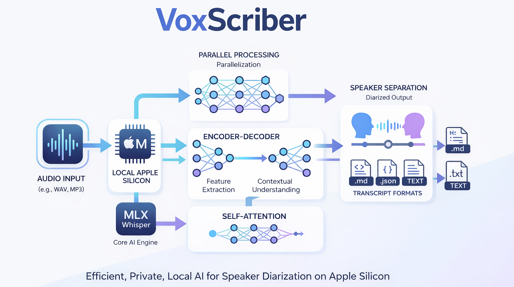

# VoxScriber

[](https://pypi.org/project/voxscriber/)
[](https://pepy.tech/project/voxscriber)
[](https://opensource.org/licenses/MIT)
[](https://www.python.org/downloads/)

Professional speaker diarization running 100% locally. Uses [Parakeet TDT 0.6B v3](https://huggingface.co/nvidia/parakeet-tdt-0.6b-v3) (via [parakeet-mlx](https://github.com/senstella/parakeet-mlx), 25 European languages) on Apple Silicon, with [MLX Whisper](https://github.com/ml-explore/mlx-examples/tree/main/whisper) as an option, and [faster-whisper](https://github.com/SYSTRAN/faster-whisper) on Linux/CUDA, combined with [Pyannote 3.1](https://github.com/pyannote/pyannote-audio).



## Requirements

- Python 3.10+
- [Hugging Face token](https://huggingface.co/settings/tokens) (free, one-time model download)
- For GPU: CUDA 12 + cuDNN 9 (optional, CPU works too)
- On macOS: FFmpeg (`brew install ffmpeg`), which the Parakeet and MLX Whisper backends use to read audio

On Linux, no FFmpeg or system packages are needed (PyAV is used as a fallback).

## Installation

```bash
pip install voxscriber
```

The right transcription backend is installed automatically:
- macOS Apple Silicon: Parakeet v3 (default) and MLX Whisper
- Linux/other: faster-whisper (CUDA or CPU)

### Setup Hugging Face Token

VoxScriber uses pyannote models which require a Hugging Face token.

**Option 1: Interactive setup (recommended)**

```bash
voxscriber-doctor
```

This will guide you through accepting the model terms and saving your token securely.

**Option 2: Using huggingface-cli**

```bash
# First, accept terms at https://huggingface.co/pyannote/speaker-diarization-3.1
huggingface-cli login
```

Your token will be saved to `~/.cache/huggingface/token` and used automatically.

**Option 3: Environment variable**

```bash
export HF_TOKEN=your_token_here
```

## Usage

```bash
# Basic
voxscriber meeting.m4a

# With known speaker count
voxscriber meeting.m4a --speakers 2

# All formats
voxscriber meeting.m4a --formats md,txt,json,srt,vtt

# Sentence-level subtitle segmentation for editing workflows (default for srt/vtt)
voxscriber meeting.m4a --formats srt,vtt

# Print to console
voxscriber meeting.m4a --print
```

### Python API

```python
from voxscriber import DiarizationPipeline, PipelineConfig

config = PipelineConfig(
    num_speakers=2,
    language="en",
)
pipeline = DiarizationPipeline(config)
transcript = pipeline.process("meeting.m4a")

for segment in transcript.segments:
    print(f"{segment.speaker}: {segment.text}")
```

## Output Formats

| Format | Description |
|--------|-------------|
| `md` | Markdown with bold speaker names |
| `txt` | Timestamped plain text |
| `json` | Structured data with word-level timestamps |
| `srt` | SubRip subtitles |
| `vtt` | WebVTT subtitles |

## Options

```
voxscriber --help

  --speakers, -s    Number of speakers (if known)
  --language, -l    Force language (e.g., 'en', 'es')
  --model, -m       Model (default: parakeet-v3 on Apple Silicon, large-v3-turbo on CUDA, small on CPU)
  --formats, -f     Output formats (default: md,txt)
  --output, -o      Output directory
  --device          auto (default), mps, cuda, or cpu
  --parallel        Run transcription and diarization at the same time (more memory)
  --srt-mode        Subtitle segmentation mode for srt/vtt: speaker|sentence
  --srt-max-duration  Maximum subtitle duration in seconds for srt/vtt
  --quiet, -q       Suppress progress
  --print           Print transcript to console
```

## Performance

Transcription and diarization run one after the other, and each model is freed before the next loads, so peak memory is the larger stage rather than the sum of both. On an M3 Pro (18 GB), a 15-minute recording takes about 76 seconds (~0.08x RTF) with a ~5.4 GB peak, versus about 13 GB when both models run at once (`--parallel`). ~0.15-0.25x RTF on NVIDIA GPUs (faster-whisper).

Parakeet v3 auto-detects the language, so `--language` only applies to Whisper models.

## Troubleshooting

Run the diagnostic tool to check your setup:

```bash
voxscriber-doctor
```

This will check FFmpeg availability and HF_TOKEN, and offer to fix common issues automatically.

### Other Issues

| Issue | Solution |
|-------|----------|
| `requires Python >= 3.10` | Use Python 3.10+: `python3.10 -m venv .venv` |
| Installed wrong package | It's `voxscriber` (with 'r'), not `voxscribe` |
| `HF_TOKEN required` | Run `voxscriber-doctor` to set up authentication |

## Support

If you find VoxScriber useful, consider supporting its development:

[](https://buymeacoffee.com/dparedesi)
[](https://github.com/sponsors/dparedesi)

## License

MIT
